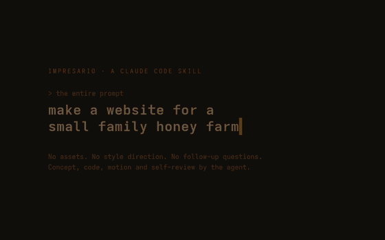

<div align="center">

# Impresario

### One sentence in, an Awwwards-style website out.

**A Claude Code skill that turns any coding agent into a creative director.**
Give it a subject and nothing else: no style, no references, no assets. It invents a concept that belongs to *that* subject, builds it with heavy, choreographed motion, screenshots its own work and revises it before handing it to you.

[**▶ Watch the demo**](https://shushant17711.github.io/impresario/) · [**Live: Holloway Honey**](https://shushant17711.github.io/impresario/holloway/) · [**Live: Veda Computers**](https://shushant17711.github.io/impresario/veda/)

<a href="https://shushant17711.github.io/impresario/"></a>

</div>

---

## The prompt was this

```text
make a website for a small family honey farm
```

That's all it was given. No brand, photos, colours, or follow-up questions. The agent decided:

> **"The site where you scroll through a beekeeping year and watch the honey rise and darken, then pour into the three jars you can buy."**

- A drop of honey falls, splashes, and the word *Holloway* rises out of it.
- A live WebGL liquid fills the **viewport itself** and rises from April to October. It darkens the way real honey does, while a Pfund colour gauge (the scale beekeepers grade honey with) tracks it.
- At harvest the honey floods the screen, then drains into three jars. **Those jars are the shop.**
- The footer is a dripping wordmark. Click it and more honey falls into the pool.

It invented the farm, family, prices and address and labelled all of them as placeholders. It then rendered the site headless, scored the screenshots against a rubric and fixed what it found before handing it over.

**[Open the live site →](https://shushant17711.github.io/impresario/holloway/)** · [read its director's sheet](docs/holloway/.impresario/direction.md)

## Why this exists

If you ask an LLM for a website, you get *The AI Website*: a centred headline over a purple gradient blob, three icon cards, and everything fading up on scroll. Swap the logo and the same page fits any business.

Impresario stops that pattern. The rules are below.

| Instead of… | Impresario does… |
|---|---|
| Asking "what style do you want?" | **Decides.** Lists its assumptions at the end so you can redirect. |
| Bolting effects onto a template | Mines the subject (verb, material, dimension, ritual), generates **5 concepts from 5 different generators**, scores them, then makes the winner *twice as bold* |
| Sections that fade in | A **journey**: scroll is a camera, sections hand off to each other, one object persists |
| Grey boxes and stock photos | **Code-native visuals**: shaders, procedural 3D, SVG illustration, kinetic type |
| "Looks good to me" | **Renders, screenshots and critiques itself** at desktop, phone and reduced motion, with a separate reviewer when one is available |

## Second test: different subject, same skill

```text
make a website for Veda Computers, a shop that repairs laptops, sets up CCTV cameras, and does other IT services
```

→ *"The site where you scroll a shattered laptop screen back to life."* The glass cracks on load. Each crack gets diagnosed with a price tag and rewired into copper traces. The repaired screen becomes one feed on a wall of CCTV cameras, and the page ends on a job card stamped **READY FOR PICKUP**. **[Live →](https://shushant17711.github.io/impresario/veda/)**

## Install

**Claude Code**

```bash
git clone https://github.com/Shushant17711/impresario ~/.claude/skills/impresario
```

**Codex / other agents that read `~/.agents/skills`**

```bash
git clone https://github.com/Shushant17711/impresario ~/.agents/skills/impresario
```

Then just ask for a website. The skill triggers on any website, landing page, portfolio or hero request, and also when you say a result "looks generic".

For the self-review screenshots you need Node 18+ and a local Chrome or Chromium. Nothing to `npm install`.

## What's inside

| File | What it does |
|---|---|
| `SKILL.md` | The workflow: absorb → study greatness → invent → choreograph → build → self-review → handoff |
| `references/exemplars.md` | Notable sites taken apart (Apple product pages, Stripe, Bruno Simon, Igloo Inc, neal.fun, Lusion…). For each: what the visitor experiences, the technique, why it works and how to translate it |
| `references/idea-engine.md` | How the agent invents a concept without asking: subject mining, 5 generators, scoring, anti-generic gate |
| `references/signature-moves.md` | Laws of flow plus 15 working GSAP / shader / Three.js recipes |
| `assets/motion-kit.js` | Shared setup with no visual style of its own: Lenis + GSAP sync, reduced motion, magnetic cursor, text reveals, full-screen shader canvas |
| `scripts/shoot.mjs` | Zero-config headless capture (desktop / phone / reduced-motion contact sheets, WebGL included) used in the self-review loop |

Accessibility isn't optional. Content lives in the DOM, links are real, keyboard focus is visible, and `prefers-reduced-motion` gets a composed static version.

## Tests

```bash
node --test tests/*.test.mjs
```

## License

[MIT](LICENSE) © Shushant Kumar Choudhary
